# Пульт доставки: прогноз числа заказов готовой еды по зонам

Отчёт по проектной работе дисциплины «Проектный практикум». Тема № 15 — «Доставка готовой еды», прогнозируемый показатель — число заказов по зонам доставки. Версия отчёта — 13 ноября 2026 года. Оформленный документ собирается командой `python tools/build_report.py`.

## 1. Постановка задачи

Служба доставки распределяет курьеров между зонами города. Если в зоне заказов больше, чем она может обслужить, растут опоздания; если меньше — курьеры простаивают. Решение о перераспределении принимает диспетчер вечером накануне.

Цель работы — прототип прогнозно-аналитической системы, которая каждый вечер в 20:00 по Москве прогнозирует число заказов на следующие сутки в каждой из шести зон и сравнивает прогноз с плановой мощностью зоны. Система должна объяснять прогноз, показывать, насколько ему можно верить, замечать ухудшение качества и управлять версиями модели.

Задачи:

1. Собирать данные из двух разнородных источников с догрузкой, повторной загрузкой без дублей, обработкой сбоев и журналом запусков.
2. Проверять и очищать данные, строить признаки одним кодом для обучения и прогноза, не допуская утечки будущих значений.
3. Сравнить базовую модель и модели разных классов по единой временной схеме проверки, выразить ошибку в заказах.
4. Показать результаты на интерактивной панели, ориентированной на решение диспетчера.
5. Реализовать два дополнительных компонента: интерпретируемость моделей и мониторинг качества с переобучением.
6. Обеспечить запуск одной командой и воспроизводимость.

Единица прогноза — число уникальных заказов, оформленных в зоне за московские сутки. Прогноз не равен очереди заказов в текущий момент и не переводится в число курьеров без модели производительности.

## 2. Предметная область

Рассматривается служба доставки готовой еды в Москве. Территория старой Москвы разделена на шесть зон, собранных из административных округов: Центр (ЦАО), Север (САО и СВАО), Восток (ВАО и ЮВАО), Юг (ЮАО и ЮЗАО), Запад (ЗАО), Северо-запад (СЗАО). У каждой зоны задана плановая мощность — сколько заказов в сутки она обслужит текущими силами.

Пользователь системы — диспетчер. Вопросы, на которые отвечает пульт:

- где завтра ожидается больше заказов, чем позволяет мощность, и насколько;
- почему модель ждёт именно такой спрос;
- насколько точны прогнозы и не ухудшилась ли модель;
- какая версия модели работает и почему.

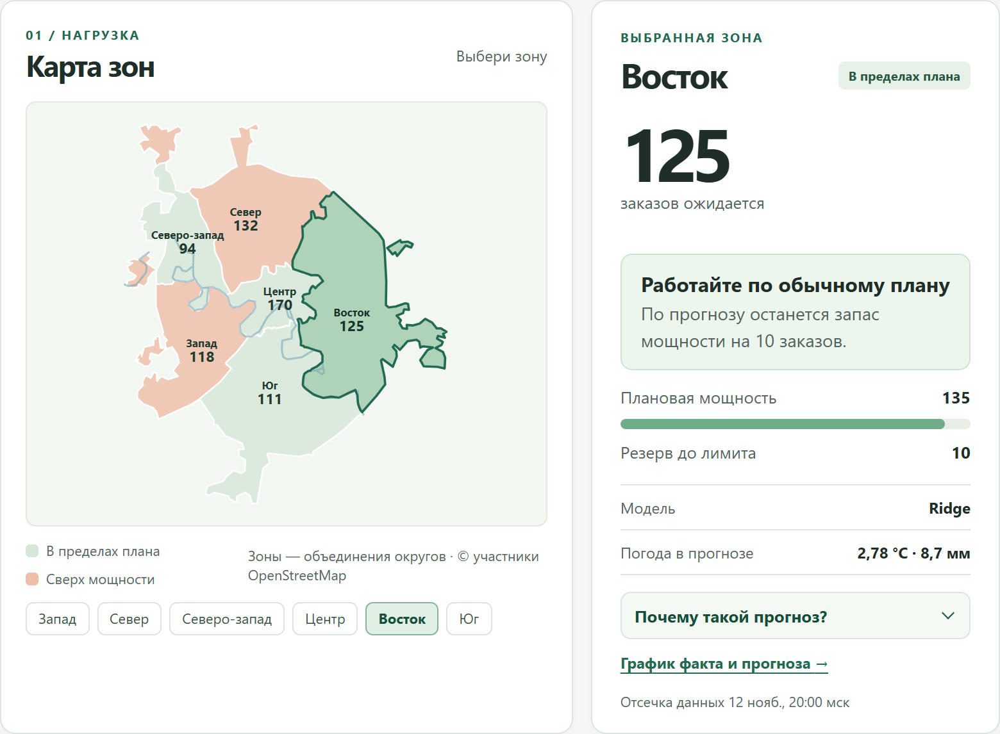

Спрос на доставку имеет выраженную недельную сезонность: в пятницу и субботу заказов больше, чем в понедельник. Зоны различаются средним уровнем спроса. Погода может влиять на реальный спрос, но в учебных данных этот эффект не моделируется (раздел 3).

## 3. Данные

Таблица: Источники данных

| Источник | Формат и способ получения | Что используется |
| --- | --- | --- |
| Журнал событий сервиса заказов | Текстовые строки: время, уровень, тип события, поля в произвольном порядке, свободный текст, служебные записи, повторная доставка событий. Синтетический генератор с seed=42 выдаёт журнал за каждые закрытые сутки | ID, время и зона заказа → суточные CSV → число заказов по зонам |
| Open-Meteo Previous Runs API | HTTP JSON с вложенными почасовыми массивами; модель ECMWF IFS, прогноз с заблаговременностью 48 часов | Средняя температура, сумма осадков, число часов с осадками за московские сутки |
| Open-Meteo Forecast API | HTTP JSON | Погода в Москве сейчас — только для показа диспетчеру |
| OpenStreetMap | Границы административных округов, собраны один раз | Карта зон |

Журнал событий — слабоструктурированный источник: из свободного текста извлекаются поля, служебные строки отбрасываются, повторно доставленное событие не удваивает заказ. Погодный источник отличается и способом получения (HTTP API), и форматом (JSON). Для обучения берутся именно прогнозы погоды, выпущенные заранее, а не измеренная погода: к 20:00 накануне фактическая погода целевых суток ещё неизвестна.

Заказы синтетические: на момент работы нет открытого источника заказов по зонам Москвы. Генератор задаёт средний уровень зоны, недельные коэффициенты от 0,93 (понедельник) до 1,19 (суббота) и случайное отклонение около 6%. Персональных данных нет; учётные записи пользователей пульта в моделировании не участвуют. Погода в генераторе не используется, поэтому выводы о влиянии погоды на реальный спрос делать нельзя.

Объём на 11 ноября 2026 года: 365 суток, 250 829 заказов, 2 106 наблюдений «зона × сутки» в обучающей таблице (первые 14 суток уходят на лаги). Новые сутки догружаются ежедневно.

Загрузка устроена так:

- **Инкрементальность.** Повторный запуск генерирует и разбирает только отсутствующие сутки; погода запрашивается только для недостающих дат.
- **Идемпотентность.** Повторный разбор того же журнала даёт тот же CSV. Повторная публикация на ту же дату пропускается. Записи мониторинга имеют уникальные ключи.
- **Устойчивость к сбоям.** Таймауты, ошибки 5xx и лимиты (429 с учётом Retry-After) повторяются с ограниченным числом попыток. При ошибке прежний прогноз остаётся доступен, планировщик повторяет попытку через 5 минут.
- **Журнал загрузок.** Для каждого запуска сохраняются время, целевая дата, этап, число новых и повторно использованных суток, происхождение погоды, версия модели и текст ошибки. Журнал виден во вкладке «Журнал».

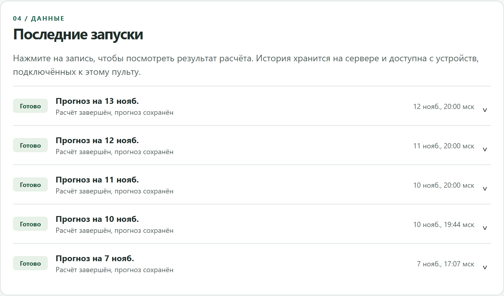

## 4. Обработка данных и признаки

### 4.1. Проверки качества

Таблица: Проверки качества данных

| Проверка | Решение |
| --- | --- |
| Пустой ID, неизвестная зона, время вне суток, конфликт полей одного ID | Остановить загрузку, сохранить причину |
| Повтор того же события | Учесть один раз |
| Нет завершающей записи журнала или данных по зоне | Не публиковать неполные сутки |
| Неполные почасовые массивы погоды | Суточный признак остаётся пропуском, а не нулём |
| Необычное число заказов | Отметить и сохранить: скачок может быть настоящим спросом |

Необычный спрос определяется по прошлому: день сравнивается с медианой последних восьми таких же дней недели в зоне, порог — max(6·MAD, 50% медианы, 1). На 11 ноября проверено 365 суток и 250 829 заказов; сигналов необычного спроса нет, неполных дней погоды — 29.

### 4.2. Признаки

Прогноз на день D выпускается в 20:00 дня D−1; последний полностью закрытый день — D−2. Все признаки для обучения, проверки и ежедневного прогноза строит одна функция `features_for_day`.

Таблица: Признаки модели

| Группа | Признаки | Кодирование и обработка |
| --- | --- | --- |
| Лаги | Заказы зоны за D−2, D−7, D−14 | Только закрытые сутки; лаг 1 исключён |
| Окно | Среднее за D−8…D−2 | Семь закрытых суток |
| Календарь | День недели | Категория |
| География | Зона | Категория |
| Погода | Средняя температура, осадки, часы с осадками | Прогноз за 48 часов; пропуски сохраняются |

Категории для Ridge кодируются one-hot: у дня недели и зоны нет естественного порядка, а линейная модель с порядковым кодом навязала бы ложную монотонность. CatBoost получает категории напрямую; при числе значений до семи (`one_hot_max_size = 7`) он сам кодирует их one-hot внутри деревьев. Пропуски числовых признаков для Ridge заполняются медианой обучающего окна с индикатором пропуска, затем признаки стандартизируются; CatBoost обрабатывает пропуски сам. Все преобразования обучаются внутри соответствующего временного окна.

### 4.3. Отбор признаков

Отбор погодной группы встроен в выбор модели: каждая обучаемая модель проверяется с погодой и без неё на одних и тех же окнах. Дополнительно для Ridge по очереди исключались группы признаков (504 наблюдения валидации; отложенный тест не использовался).

Таблица: Исключение групп признаков для Ridge

| Вариант Ridge | MAE, заказа | Изменение |
| --- | ---: | ---: |
| Все признаки | 5,566 | — |
| Без погоды | 5,567 | +0,002 |
| Без истории заказов | 5,554 | −0,012 |
| Без дня недели | 6,353 | +0,788 |

Надёжно полезен календарь. Погода практически не помогает — это ожидаемо, раз генератор её не использует. Лаги избыточны относительно зоны и дня недели, пока спрос стационарен. Они оставлены, потому что первыми переносят в прогноз новый уровень спроса, если он меняется. Разницу в тысячные доли заказа не считаем значимой.

### 4.4. Отсутствие утечки

- Признаки на дату D используют только сутки по D−2 включительно и погодный прогноз, доступный к 20:00 D−1.
- При проверке на окне, начинающемся в день S, модель обучается на сутках до S−2: к 20:00 S−1 сутки S−1 ещё не закрыты.
- Тест меняет будущие заказы и проверяет, что более ранние признаки и прогнозы не изменились.
- Ежедневный прогноз запрещён, если рабочая версия модели обучена на данных позже D−2.
- Отбор признаков и гиперпараметры не используют отложенный тест.

## 5. Модели и результаты проверки

### 5.1. Модели

- **Сезонная база** — число заказов в той же зоне неделю назад (наивный прогноз).
- **Ridge** — линейная регрессия с L2-регуляризацией (alpha = 1).
- **CatBoost** — градиентный бустинг деревьев: 250 итераций, глубина 5, шаг 0,05, учёт порядка времени.

Обучаемые модели проверяются в двух вариантах — с погодой и без. Seed = 42; параметры, версии библиотек и SHA-256 обучающей таблицы сохраняются вместе с результатом.

### 5.2. Схема проверки

Данные делятся только по времени. Последние 28 суток (168 наблюдений) отложены для итоговой оценки. Перед ними — три последовательных окна валидации по 28 суток (504 наблюдения). В каждом окне модель обучается на всех более ранних закрытых сутках. Победитель выбирается по среднему MAE окон до расчёта итогового теста, затем проверяется на отложенном периоде и обучается на всей доступной истории.

Метрики:

- **MAE** — на сколько заказов в среднем прогноз отличается от факта в одной зоне за сутки. Это величина, понятная диспетчеру.
- **WAPE** — сумма абсолютных ошибок, делённая на сумму фактических заказов, в процентах. Позволяет сравнивать зоны и периоды с разным уровнем спроса.

### 5.3. Результаты

Версия данных 11 ноября 2026 года ([model-results.json](model-results.json)):

Таблица: Сравнение моделей на трёх окнах валидации

| Вариант | MAE валидации, заказа | WAPE валидации |
| --- | ---: | ---: |
| Сезонная база | 7,64 | 6,67% |
| Ridge без погоды | 5,57 | 4,86% |
| Ridge с погодой | 5,57 | 4,86% |
| CatBoost без погоды | 5,77 | 5,03% |
| CatBoost с погодой | 5,72 | 4,99% |

Выбран Ridge (с погодой — с разницей около 0,002 заказа). На отложенном периоде 13 октября — 9 ноября (обучение по 11 октября) выбранная модель ошибалась в среднем на 5,81 заказа в зоне за сутки (WAPE 5,07%), база — на 7,95 (6,93%). Промах меньше примерно на 27%, то есть около двух заказов на зону в день.

В версии от 13 ноября, которая работает сейчас, выбран Ridge без погоды; её промах на отдельном тесте — 5,86 заказа. Линейная модель выигрывает у бустинга потому, что спрос в данных складывается из уровня зоны и недельного коэффициента почти аддитивно: деревьям нечего добавить к этой структуре, а дисперсия у них выше.

Результат получен на синтетических данных: он подтверждает корректность системы, но не обещает такой точности на реальной доставке.

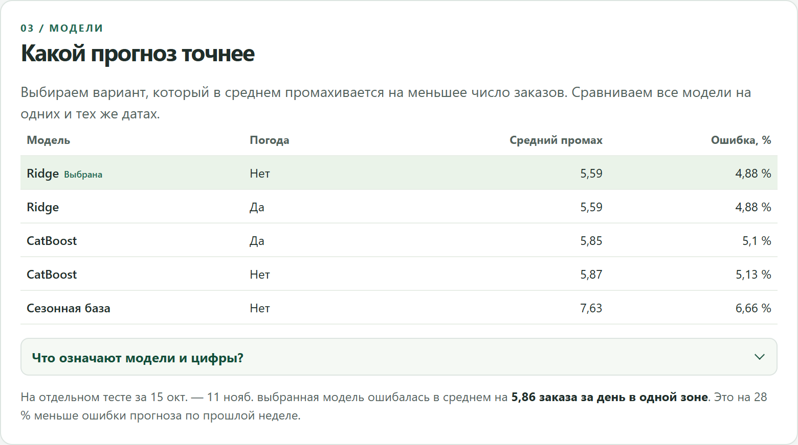

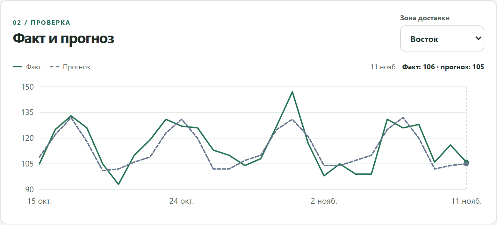

### 5.4. Воспроизводимость

Обучение воспроизводится по сохранённым параметрам и SHA-256 данных: команда `python -m backend.modeling.verify_reproduction --date 2026-11-11` строит журналы заново во временном каталоге и сверяет контрольные суммы, параметры, метрики и прогнозы. Каждая версия модели хранится в реестре вместе с паспортом: признаки, параметры, seed, версии Python и библиотек, период обучения, метрики.

## 6. Дополнительные компоненты

### 6.1. Интерпретируемость

1. **Важность признаков двумя независимыми способами.** Средний модуль вклада признака в прогноз (в заказах) и рост MAE после случайного перемешивания признака (permutation importance). Во вкладке «Качество» для рабочей Ridge главный признак — зона (перемешивание увеличивает промах на 12,8 заказа), затем день недели.
2. **Объяснение отдельного прогноза.** Кнопка «Почему такой прогноз?» в карточке зоны: базовый уровень и вклад каждого признака в заказах. Для Ridge — вклад линейных членов относительно среднего по обучающей истории; для CatBoost — значения SHAP; для базы — дата и число заказов неделей ранее. Базовый уровень плюс вклады дают прогноз до округления.
3. **Зависимость прогноза от признака.** Блок «Что изменится, если…»: меняется одно условие (температура или заказы неделю назад) в пределах наблюдавшихся значений зоны, остальные признаки фиксированы; модель пересчитывает прогноз (индивидуальная кривая ICE).
4. **Сравнение периодов.** Важность считается отдельно для трёх окон валидации; переключатель периода показывает, меняется ли структура.

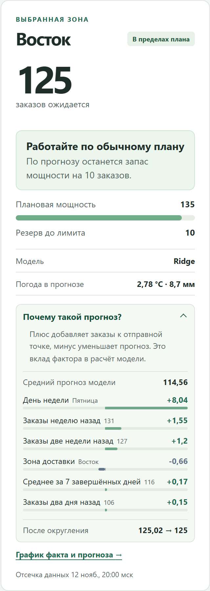

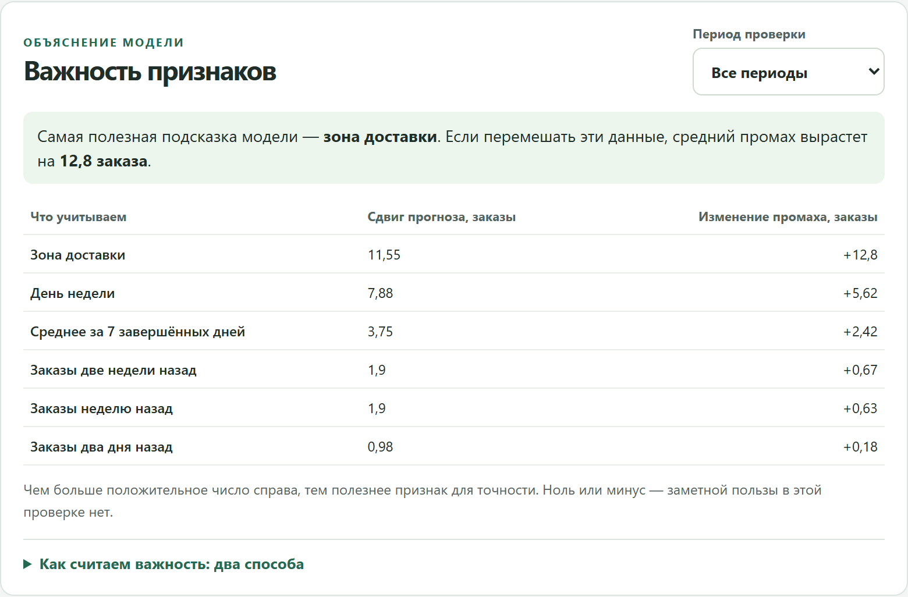

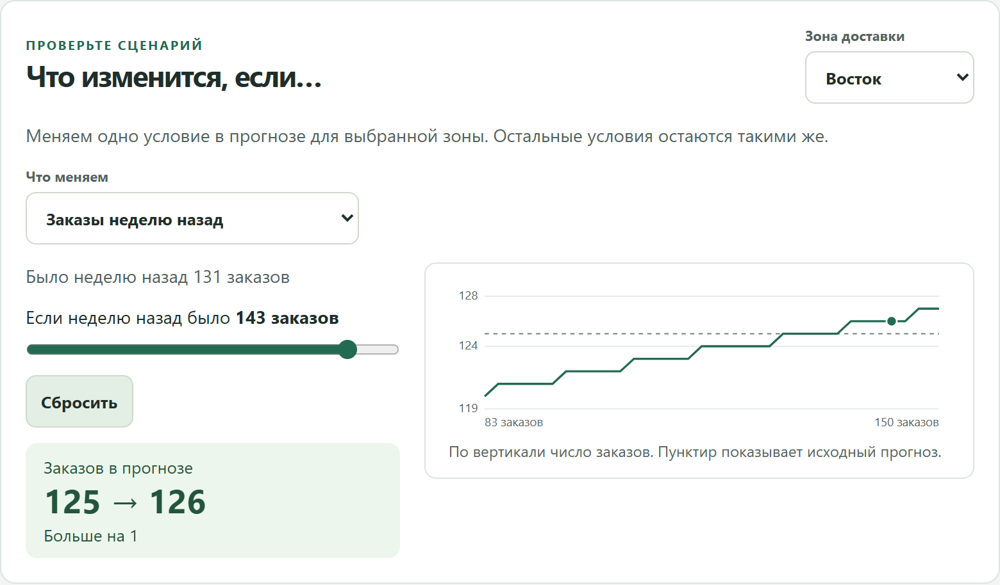

На защите прогноз для произвольной зоны и даты объясняется так: выбрать дату и зону на вкладке «Прогноз», раскрыть «Почему такой прогноз?», затем показать важность и сценарий на вкладке «Качество».

### 6.2. Мониторинг качества и переобучение

**Качество на фактических данных** (`weekly-error-v1`). Прогноз сохраняется до начала суток; после полуночи к нему добавляется факт. Для каждой зоны берутся до 14 последних закрытых суток подряд. Средний промах недели сравнивается с порогом — средней ошибкой проверки этой модели × 1,3. Одна неделя выше порога — предупреждение, две подряд — сигнал «обучить и проверить новую модель». Решения неизменяемы и хранятся по ключу «версия правила, зона, дата».

**Изменение входных данных** (`input-drift-v1`). Последние 14 закрытых дат сравниваются с зафиксированной опорой из 56 дат. Мера — наибольший разрыв эмпирических функций распределения (статистика Колмогорова — Смирнова), для заказов — после вычета медианы своего дня недели; сигнал — от 45 процентных пунктов. Первая проверка показала сдвиг прогнозной температуры (медиана с 11,4 до 2,1 °C, разрыв 89 п. п.) — это смена сезона, признаки заказов на Востоке в пределах порога.

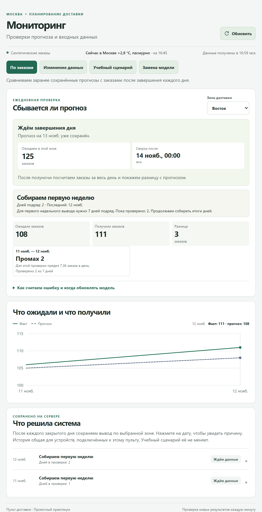

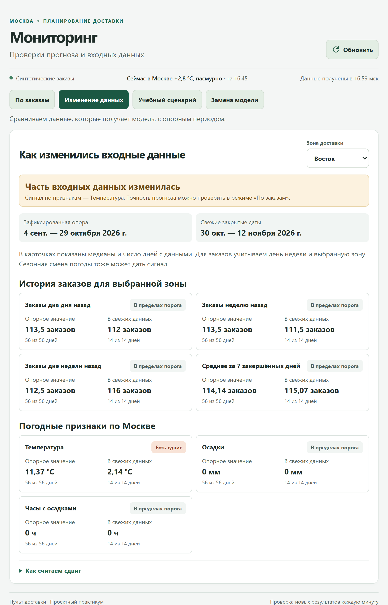

**Реестр версий.** Хранит обученный экземпляр модели и паспорт: состав и версию признаков, параметры, seed, SHA-256 данных, период обучения, метрики проверки, версии библиотек, контрольную сумму артефакта. Ежедневный прогноз считает сохранённая рабочая версия без переобучения; перед расчётом сверяются контрольная сумма, версия признаков и окружение.

**Правило переобучения** (`retrain-v1`). Сигнал мониторинга по текущей рабочей версии ставит одно задание; повторный сигнал в течение недели нового задания не создаёт. Администратор может запустить проверку вручную.

**Новая версия** (`candidate-v1`). Та же процедура выбора модели, но обучение — только на днях до контрольной недели, и свежие дни весят больше (вес уменьшается вдвое каждые 14 дней). Без этого веса переобучение на годе истории почти не догоняет сдвиг спроса: на учебном сдвиге +35% промах снизился бы лишь с 11,1 до 10,4 заказа, с весом — до 6,6.

**Правило вывода в эксплуатацию** (`promotion-v1`). Обе версии прогнозируют одну контрольную неделю — 7 последних закрытых суток, не входивших в обучение ни одной из них. Новая версия заменяет рабочую, если её MAE не больше 95% MAE рабочей и не больше MAE базы. Замена, запись в журнал и сохранение версии выполняются одной транзакцией.

**Возврат к предыдущей версии.** Администратор возвращает версию, работавшую до текущей; действие проверяет, что рабочая версия не сменилась. Опубликованные прогнозы, факты и решения не переписываются, откат действует со следующего расчёта.

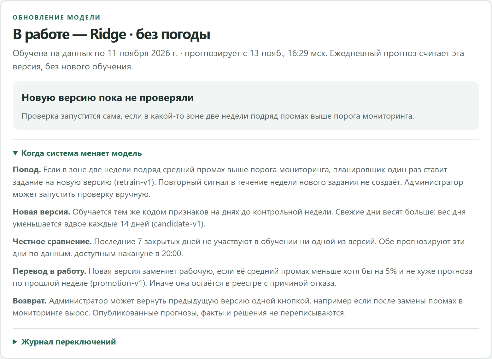

**Демонстрация реакции на ухудшение.** Учебный цикл проигрывает 13 октября — 12 ноября 2026 года тем же кодом планировщика на отдельной копии данных, где на Востоке с 20 октября добавлено 35% заказов:

Таблица: События учебного цикла обновления модели

| Дата | Событие |
| --- | --- |
| 19 октября | Проверка без повода: новая версия на 6,9% хуже — отказ |
| 21 октября | Предупреждение мониторинга на Востоке |
| 26 октября | Случайный сигнал на Северо-западе без сдвига: выигрыш 4,8% < 5% — отказ |
| 28 октября | Две недели выше порога на Востоке |
| 2 ноября | Контрольная неделя 27 октября — 2 ноября: MAE 7,02 против 9,38 (на Востоке 14,0 против 33,1) — новая версия в работе с 4 ноября |
| 11 ноября | Последняя неделя снова в пределах порога |
| 13 ноября | Откат администратором; опубликованные прогнозы новой версии не изменились |

Промах на Востоке после сдвига — 37,6 заказа в сутки до замены и 9,8 после. Результаты мониторинга сохраняются в PostgreSQL и доступны во вкладке «Мониторинг».

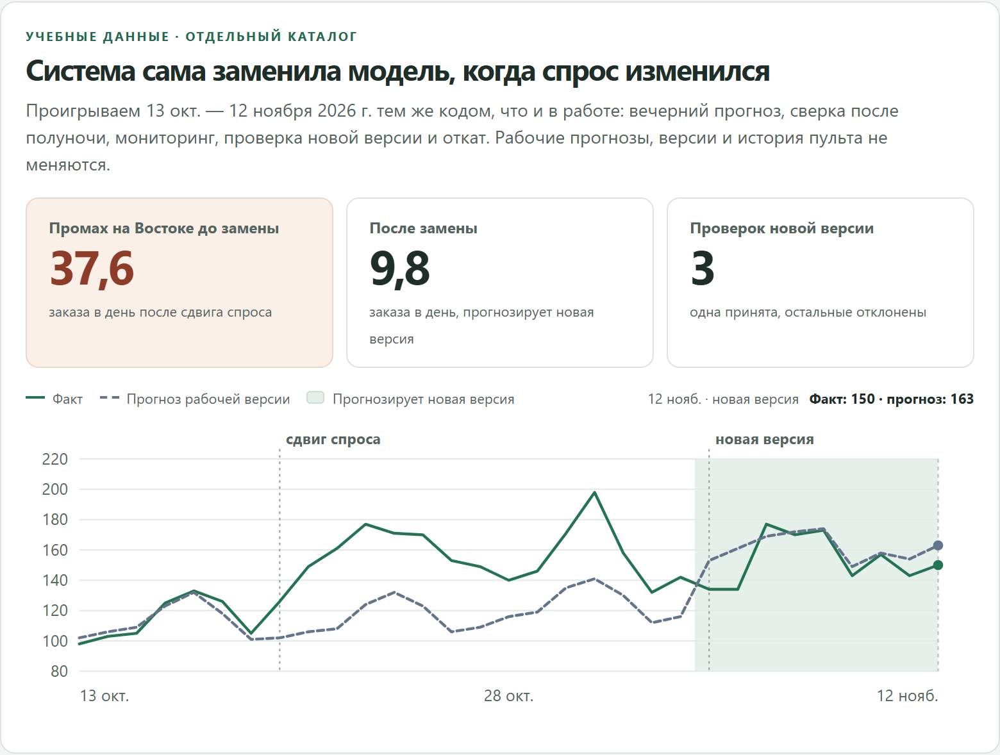

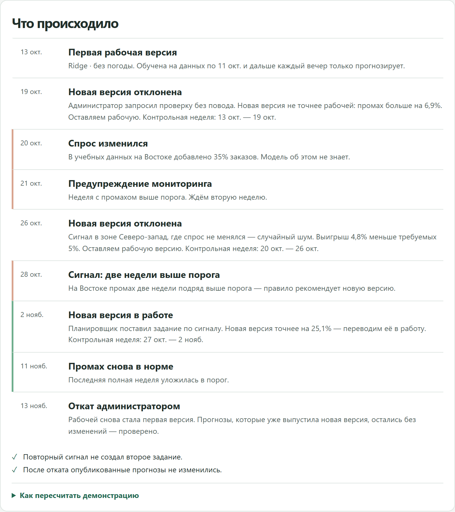

## 7. Архитектура и технологический стек

Система состоит из пяти сервисов Docker Compose:

- **db** — PostgreSQL 17: прогнозы, факты, решения мониторинга, дрейф, реестр и журнал моделей, журнал запусков, аккаунты.
- **init** — создаёт таблицы и импортирует результаты из файлов при первом запуске.
- **worker** — планировщик: в 20:00 мск публикует прогноз, после полуночи сверяет факт, проверяет дрейф, обучает и проверяет новую версию модели.
- **web** — FastAPI: HTTP API и статическая сборка интерфейса.
- **minio** — S3-совместимое хранилище аватаров пользователей.

Сырые журналы, CSV и ответы погодного API лежат в каталоге `data/` и служат кэшем для повторных запусков. Интерфейс на React и TypeScript опрашивает API раз в минуту.

Обоснование стека. Python — стандарт для анализа данных и машинного обучения; scikit-learn и CatBoost покрывают линейную модель и бустинг, а SHAP встроен в CatBoost. FastAPI даёт типизированные HTTP-роуты и документацию API. PostgreSQL обеспечивает транзакции и уникальные ключи, на которых держатся идемпотентность и неизменяемость решений, а advisory lock не даёт двум процессам считать одно и то же. Собственный интерфейс на React вместо BI-платформы позволил построить экран вокруг решения диспетчера и встроить объяснения и действия администратора. Docker Compose запускает всё одной командой; настройки задаются переменными окружения.

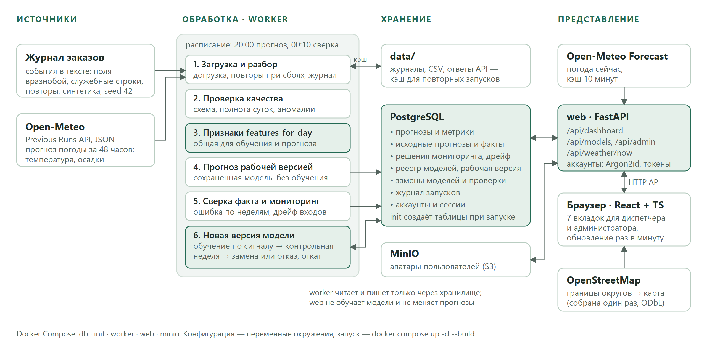

## 8. Проверка

- 49 серверных тестов: загрузка и разбор журналов, временные признаки и утечка, качество данных, объяснения и сценарии, реестр, мониторинг, дрейф, жизненный цикл модели (включая полный цикл со сдвигом на синтетике), планировщик, погода сейчас, HTTP API с PostgreSQL (права, транзакции, пагинация), хранение аватаров в MinIO.
- 5 тестов интерфейса и production-сборка.
- GitHub Actions запускает серверные тесты с PostgreSQL и сборку интерфейса.
- Интеграционные тесты работают в отдельной временной схеме базы и не трогают рабочие данные.
- Ручная приёмка сценариев и узкого экрана описана в [requirements.md](requirements.md).

## 9. Выводы

Создан работающий прототип прогнозно-аналитической системы полного цикла: от сбора данных из двух разнородных источников до ежедневного прогноза, панели для диспетчера и управления версиями модели.

- На учебных данных выбранная модель Ridge ошибается в среднем на 5,8 заказа в зоне за сутки — примерно на четверть меньше, чем повтор прошлой недели.
- Прогноз объясняется вкладами признаков в заказах, а важность подтверждена двумя способами.
- Система замечает рост ошибки и изменение входных данных и сама обучает новую версию. Версию она заменяет только после честной проверки на днях вне обучения и даёт администратору откатиться без потери истории.

## 10. Ограничения

- Заказы синтетические и стационарные; погода в них не влияет на спрос. Выводы о пользе погоды и о точности на реальных данных сделать нельзя.
- Мощность зон постоянна и задана вручную; модель производительности курьеров и маршрутов нет. Совет курьеру на главном экране показан только на явно вымышленном примере.
- Нет доверительных интервалов прогноза.
- Пороги мониторинга (×1,3, 45 п. п., выигрыш 5%) выбраны для учебной системы и не калиброваны по частоте ложных срабатываний; контрольная неделя — всего 42 наблюдения.
- Откат выполняет администратор, автоматического отката нет.
- Пульт опубликован только на 127.0.0.1; для доступа с других устройств нужен HTTPS.

## Источники

1. Методические указания к проектной работе по дисциплине «Проектный практикум».
2. Open-Meteo. Previous Runs API. https://open-meteo.com/en/docs/previous-runs-api
3. Open-Meteo. Weather Forecast API. https://open-meteo.com/en/docs
4. OpenStreetMap. Copyright and License (ODbL 1.0). https://www.openstreetmap.org/copyright
5. scikit-learn. Partial dependence and individual conditional expectation plots. https://scikit-learn.org/stable/modules/partial_dependence.html
6. scikit-learn. Permutation feature importance. https://scikit-learn.org/stable/modules/permutation_importance.html
7. scikit-learn. Model persistence. https://scikit-learn.org/stable/model_persistence.html
8. CatBoost. Feature importance: ShapValues. https://catboost.ai/docs/en/concepts/fstr
9. NIST/SEMATECH. Kolmogorov–Smirnov two-sample test. https://www.itl.nist.gov/div898/software/dataplot/refman1/auxillar/ks2samp.htm
